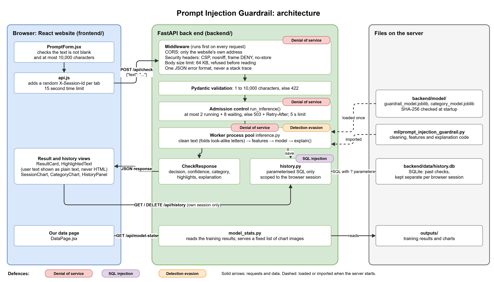

# Prompt Injection Guardrail (COS30049 Assignment 3)

**Session 11, Group 3:** Zahara Rashini Amarasiri Gunawardana, Le Thuy Duong Nguyen, Tomas Agustin Cornejo Beltran

A website that checks a prompt **before** it reaches an AI assistant and **allows** it or **blocks** it as a prompt
injection, with the model's confidence, the words that triggered it and a one-line explanation.
React front end, FastAPI back end, and the scikit-learn model from Assignment 2.

## Documentation

| Read this | For |
|---|---|
| **This README** | Setting up a clean machine, starting, stopping, re-running and testing |
| [docs/running.md](docs/running.md) | The full guide: every step explained, retraining, security demos, settings, troubleshooting |
| [docs/architecture.md](docs/architecture.md) | What the app is, how a request flows through it, endpoints, pinned versions |
| [docs/security.md](docs/security.md) | Threat model, the three defences to be marked, before and after results |
| [docs/model.md](docs/model.md) | The machine learning model: data, training, test results |
| [docs/code-guide.md](docs/code-guide.md) | Where every file is and what it does |
| [docs/references.md](docs/references.md) | References (Swinburne Harvard) |

## Quick start

### 1. You need

[Miniconda](https://docs.conda.io/en/latest/miniconda.html) (or Anaconda), [Node.js](https://nodejs.org/) 22 or later, and Git.
Commands below work in PowerShell, Anaconda Prompt, or a macOS/Linux terminal.

### 2. Set up (once)

```bash
git clone https://github.com/9zigzag9/guardrail.git
cd guardrail
conda env create -f environment.yml
cd frontend
npm ci
cd ..
```

### 3. Start (every time), from the project folder

Terminal 1, the back end:

```bash
conda activate guardrail
python -m uvicorn backend.main:app --port 8000 --no-server-header
```

Wait for `Application startup complete`. Then terminal 2, the website:

```bash
cd frontend
npm run dev
```

### 4. Check it works

Open **http://localhost:5173**. The status pill should be green. Choose the *Direct injection* example and select
**Check prompt**: it should be **Blocked**. The API documentation is at http://localhost:8000/docs.

### 5. Stop, re-run and reset

- **Stop:** press `Ctrl` + `C` in both terminals.
- **Re-run:** repeat step 3. Setup (step 2) is only needed once.
- **Start with an empty history:** stop the back end and delete `backend/data/history.db`.
- **After pulling new code:** `conda env update -f environment.yml --prune`, then `npm ci` in `frontend/`.

### 6. Run the tests

No server needed:

```bash
conda activate guardrail
python -m pytest -q
cd frontend
npm run lint
```

All 80 tests should pass.

### 7. Retrain the model (optional)

```bash
python ml/prompt_injection_guardrail_hf.py --repos data/dataset_clean.csv
```

The website's **Our data** page shows the new results straight away. To make the website *use* the new model, follow
[docs/running.md, section 7.3](docs/running.md#73-deploy-the-new-model).

Something not working? See [troubleshooting](docs/running.md#10-troubleshooting).

## Security work to be marked

| Section | Choice | Level | Details |
|---|---|---|---|
| 2.7 Defence 1 | Denial of service | Advanced | [security.md](docs/security.md#defence-1-denial-of-service-advanced) |
| 2.7 Defence 2 | SQL injection (history of past checks) | Intermediate | [security.md](docs/security.md#defence-2-sql-injection-intermediate) |
| 2.8 Advanced security | Detection evasion (look-alike letters) | Advanced | [security.md](docs/security.md#advanced-security-detection-evasion) |

## Architecture in brief



One request traced step by step, and the endpoint list, are in [docs/architecture.md](docs/architecture.md).

## Threat model in brief

- **Who attacks:** someone who wants an injection **allowed**; someone who wants the guardrail slow or down; another
  user who wants to read prompts other people checked.
- **What they can do:** send any HTTP request directly (no need for our website), including crafted text, unusual
  Unicode, SQL syntax and thousands of requests. They cannot log in or change files on the server.
- **What we defend:** denial of service, SQL injection and look-alike letter evasion, as above.

The full threat model, and why the other section 2.7 risks do or do not apply, is in [docs/security.md](docs/security.md#threat-model).

## Pinned versions

Python 3.14, FastAPI 0.162.0, Starlette 1.10.0, Pydantic 2.14.1, uvicorn 0.54.0, scikit-learn 1.9.1, pandas 3.0.6,
numpy 2.5.3. Node.js 22, React 19.3.1, Vite 8.3.5, react-router-dom 7.18.4, Recharts 3.10.1.
Every version is pinned in `ml/requirements.txt`, `backend/requirements.txt` and `frontend/package-lock.json`; the full
table is in [docs/architecture.md](docs/architecture.md#pinned-dependency-versions).

## References

The full reference list (Swinburne Harvard style) is in [docs/references.md](docs/references.md).
