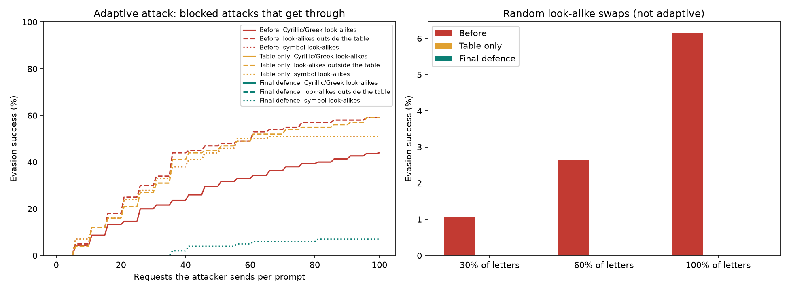

# Security: the defences and their results

[Back to README](../README.md)

Contents: [Work to be marked](#security-work-to-be-marked) ·
[Threat model](#threat-model) ·
[Defence 1: denial of service](#defence-1-denial-of-service-advanced) ·
[Defence 2: SQL injection](#defence-2-sql-injection-intermediate) ·
[Advanced: detection evasion](#advanced-security-detection-evasion) ·
[Hygiene](#security-hygiene-and-other-measures) ·
[Limitations](#limitations-and-next-steps)

## Security work to be marked

| Section | Choice | Level | Where it is explained |
|---|---|---|---|
| 2.7 Defence 1 | **Denial of service** | Advanced | [Defence 1](#defence-1-denial-of-service-advanced) |
| 2.7 Defence 2 | **SQL injection** (in the history of past checks) | Intermediate | [Defence 2](#defence-2-sql-injection-intermediate) |
| 2.8 Advanced security | **Detection evasion** | Advanced | [Advanced security](#advanced-security-detection-evasion) |

The security hygiene requirements (section 2.3) and the hash check on the model file are also in place, but are not
submitted for marking as defences.

## Threat model

The threat model is in the [README](../README.md#threat-model), where the assignment asks for it: who would
attack the application, what they want, what they can do, and which section 2.7 risks apply. The defences below
follow from it.

## Defence 1: Denial of service (Advanced)

**The attack.** Running the model costs far more than sending a request, and two things made that worse in the
baseline back end (git tag `baseline-before-defences`):
- inference ran directly inside the `async` endpoint, so while one check ran, every other request (even `/api/health`)
  waited for it;
- two regular expressions in the feature code backtracked quadratically, so 10,000 characters of base64-looking text
  took over a second to process.

A few crafted requests therefore froze the server for everyone, and a flood of normal requests was accepted without
limit and queued up.

**The defence** (`backend/main.py`, `backend/inference.py`, `ml/prompt_injection_guardrail.py`):
- **Inference runs in a pool of worker processes** (`INFERENCE_WORKERS`, default 2), never on the event loop, so slow
  checks cannot block other requests. Processes rather than threads, because regular-expression matching holds Python's
  global interpreter lock, so threads would still run one at a time.
- **Admission control.** At most `INFERENCE_WORKERS + MAX_QUEUED` checks (2 + 8) are accepted at once. The next one is
  refused at once with `503` and `Retry-After: 1`, instead of piling up. A slot is only freed when its worker really
  finishes, so timed-out requests still count.
- **A 5 second time limit** per check (`INFERENCE_TIMEOUT_S`), answered with `503`.
- **The two expensive regular expressions were bounded** (`EMAIL_RE` and `STRUCT_RE`), so their cost now grows linearly.
  The features are identical on all 32,003 dataset prompts.
- **Input size is capped twice:** request bodies over 64 KB are refused before they are read (counting chunked bodies
  too), and text over 10,000 characters is refused by validation.
- A worker that crashes is replaced automatically.

**Demonstration** (`demo_requests/dos_attack.py`, run against the baseline tag and against the current code):

| Measurement | Before (baseline tag) | After |
|---|---|---|
| `/api/health` while 8 expensive checks run | 9,210 ms | 19.7 ms |
| Worst crafted 10,000-character input | 1,176 ms | about 70 ms |
| 300 rapid requests from 20 clients | 300 accepted and queued | 138 answered (200), 162 refused at once (503) |

**Cost.** Each worker process holds its own copy of the model, so memory grows with `INFERENCE_WORKERS`. Under a real
burst, some genuine users receive 503 and must retry, which the front end explains as "server busy". Throughput is capped
by the number of workers by design: it is better to refuse a few requests quickly than to make everyone wait.

## Defence 2: SQL injection (Intermediate)

**The attack.** Every check can be saved to a history (SQLite) that the user can list and search. If the search text were
pasted into the SQL, input such as `%' OR 1=1 --` would change the query and return every user's prompts, including
other people's confidential ones (attacker 3 in the threat model).

**The defence** (`backend/history.py`):
- Every query is fixed SQL text, and **every value is passed as a `?` parameter**, so input is always data. No query is
  ever built from input.
- LIKE wildcards (`%`, `_`) in a search are escaped, so a search cannot widen itself.
- **Every query is scoped to the caller's session** (`X-Session-Id`, which must be a version 4 UUID). Fetching another
  session's check ID answers 404, so IDs cannot even be confirmed to exist.
- Each session keeps at most `HISTORY_KEEP` (200) checks, so the database cannot be grown without limit.
- The search length is limited (200 characters) and the decision filter only accepts `Attack` or `Safe`.

**Demonstration** (`demo_requests/sqli_demo.py`): Alice and Bob each save checks. Bob searches for `%' OR 1=1 --`.
- **Without the defence** (the same search written the unsafe way, which exists only inside the demo script): the query
  returns Alice's private prompts.
- **With the defence** (the real API): 0 rows; the input is searched for literally.
- A stored `'); DROP TABLE checks; --` comes back unchanged as plain text, and the table still exists.

The same attacks are covered by automated tests in `tests/test_api.py` (payloads include `' OR '1'='1`, `UNION SELECT`,
`%` and `_`).

**Cost.** Almost none in speed. Each history is private to one browser tab and is lost if the tab's session ID is lost;
sharing history between users would need accounts, which would bring broken access control into scope.

## Advanced security: detection evasion

**The attack.** Attacker 1 wants an injection **allowed**. Swapping letters for characters that look identical to a
person, such as Cyrillic `р` for Latin `p`, changes what the model sees without changing what the person (or the
AI assistant) reads. The guardrail already cleaned some disguises in Assignment 2 (leetspeak, hidden characters,
base64, spaced letters, accents), using `unidecode` for other scripts. We found that `unidecode` converts by
**sound**, not by **shape**: Cyrillic `р` became `r`, so `рrompt` reached the model as `rrompt`, a word it had never
learned. Because the API returns its confidence, an attacker can also try swaps one at a time and keep only those that
lower the score.

`demo_requests/evasion_attack.py` attacks the running API exactly as an outside attacker would, through `POST /api/check`:
- **Random swaps:** every one of the 2,479 test-set attacks the guardrail blocks, with 30%, 60% or 100% of swappable
  letters replaced by Cyrillic or Greek look-alikes, repeated with 3 random seeds.
- **Adaptive attack:** reads the returned attack probability, tries 5 swaps per round and keeps the best one if it
  lowers the score, up to 100 requests per prompt, on a fixed random sample of 300 blocked attacks.
- **Two obvious variations** of the adaptive attack, on 100 prompts each: look-alikes that are **not** in our table
  (Lisu and Coptic letters), and **symbols** that look like letters (`€` for e, `|` for l, `!` for i, `+` for t, `§` for s).

**The defence** (`ml/prompt_injection_guardrail.py`, applied to every request before the text reaches the model):
1. **Fold look-alikes to the letter they imitate** (`fold_confusables`), following the "skeleton" idea of Unicode
   Technical Standard #39 (Unicode Consortium n.d.). It runs first in `clean_text`, before the rot13 check, which
   otherwise mistook disguised text for rot13 and "decoded" it into nonsense. A word is only folded if it mixes Latin
   letters with look-alikes, or is made entirely of near-identical look-alikes, so genuine Russian or Greek words
   (`привет`) are transliterated as before.
2. **Fold letter-like symbols inside words**, while keeping their genuine uses ("Hello!", "C++", "A+", "x + y", "€10",
   table bars).
3. **Block words that mix alphabets** (`mixed_script_words`). A word with Latin letters and letters from another script is
   never genuine text, so it is blocked even when the look-alike is not in our table; the explanation says so and the
   word is highlighted. This is the mixed-script check TR39 recommends and browsers use against spoofed web addresses.
   IPA marks and accented Latin letters (`/ˈroʊlɪŋ/`, `Lūʻau`, `Zürich`) do not trigger it.

Because folding happens in the cleaning step, the highlighted words are still the user's own characters.

**Results** (measured through the API; 95% confidence intervals in brackets; "Table only" is the first version of the
defence, with step 1 alone):

| Measure | Before | Table only | Final defence |
|---|---|---|---|
| Random swaps, 30% of letters (mean ± sd, 3 seeds) | 1.06% ± 0.18% | 0.00% | 0.00% |
| Random swaps, 60% of letters | 2.64% ± 0.08% | 0.00% | 0.00% |
| Random swaps, 100% of letters | 6.14% ± 0.04% | 0.00% | 0.00% |
| **Adaptive attack, look-alikes, up to 100 requests (300 prompts)** | **44.0%** [38-50%] | 0.0% [0-1%] | **0.0%** [0-1%] |
| Adaptive, look-alikes outside the table (100 prompts) | 59.0% [49-68%] | 59.0% [49-68%] | **0.0%** [0-4%] |
| Adaptive, symbol look-alikes (100 prompts) | 51.0% [41-61%] | 51.0% [41-61%] | **7.0%** [3-14%] |
| Safe test prompts wrongly blocked (cost) | 46 / 3,670 | 46 / 3,670 | 45 / 3,670 |
| Plain test attacks missed (cost) | 252 / 2,731 | 252 / 2,731 | 253 / 2,731 |
| Median response time, safe prompts (cost) | 20.7 ms | 21.2 ms | 20.2 ms |

**What the numbers show.**
- Random swaps rarely worked even before (6% at most). The model had learned that non-ASCII characters often mean
  "attack", so a disguise usually *raised* the score. The real threat is the adaptive attacker, who used the returned
  confidence to find the few swaps that lowered it: **44% of blocked attacks got through within 100 requests**
  (median 36 requests).
- **The obvious defence did not work on its own.** The look-alike table stopped the attack it was built from (44% to 0%)
  but did nothing against the two variations: an attacker simply used letters not in the table (59%) or symbols (51%).
  Only the mixed-script rule, which does not need to know which letter is being imitated, closed the first gap
  (59% to 0%), and symbol folding reduced the second (51% to 7%).
- **What still gets through:** 7 of 100 symbol attacks. Symbol folding deliberately leaves a symbol alone before a
  capital letter or a digit, and `!` or `+` at the end of a word, so that normal punctuation and money are not changed;
  those positions are the route that remains open. A whole word written only in
  letters from another script (no Latin letter in it), and rephrasing the attack in different words, are outside
  this defence.

**Cost.**
- **Accuracy:** on the unchanged test set, one fewer safe prompt is blocked (45 instead of 46) and one more attack is
  missed (253 instead of 252), so overall accuracy is unchanged at 95.4%. In the full dataset, 648 of 32,003 prompts
  are cleaned differently, 628 of them attacks that already used these disguises.
- **False blocks from the mixed-script rule:** 4 of 18,349 safe prompts in the dataset contain a mixed-alphabet word,
  and all 4 are jailbreak prompts with adversarial gibberish suffixes that the dataset labels as safe. Genuine text in
  other languages is not affected by the rule.
- **Speed:** cleaning takes about 70 µs more per prompt (84 to 157 µs), well under 1% of a 20 ms request; the measured
  median response time did not change.
- **What we gave up:** a word that mixes alphabets is blocked even if the rest of the prompt is harmless, so a user who
  pastes, for example, a product code mixing Latin and Greek letters is refused, with an explanation. We accepted
  this because no genuine prompt in 18,349 did it, while 130 attacks did. A weakness that remains is that the model
  itself scores many non-English prompts as attacks (for example "привет, how are you?"), a training-data limitation
  from Assignment 2 that this defence did not change.

**How to reproduce:** see [running.md, section 8](running.md#8-security-demos). The version before the defence is the git tag `before-evasion-defence`;
raw results are in `outputs/evasion_before.json`, `outputs/evasion_after_table.json` and `outputs/evasion_after.json`.

## Security hygiene and other measures

- **Input never rendered as HTML.** The highlighted words are rebuilt from the API's `segments` as React text; there is no
  `dangerouslySetInnerHTML` anywhere, so `` is shown as text.
- **Size limits on the back end:** 10,000 characters of text and 64 KB per request body.
- **CORS** allows only the front end's exact origins (`http://localhost:5173` and `http://127.0.0.1:5173`).
- **No secrets** are needed or stored; every setting is an environment variable (`backend/.env.example`).
- **Model integrity:** the model files' SHA-256 hashes are checked at startup and the server refuses to start on a mismatch.
- **Security headers** on every response: `Content-Security-Policy`, `X-Content-Type-Options`, `X-Frame-Options`,
  `Referrer-Policy` and `Cache-Control: no-store`. Uvicorn runs with `--no-server-header`.
- **One error format** for every error, `{"error": {"code": "...", "message": "..."}}`, with no stack traces.
- **Dependency audit:** `pip-audit -r backend/requirements.txt` reports no known vulnerabilities, and `npm audit --omit=dev`
  reports none in the packages shipped to users. `npm audit` reports 4 moderate findings in ESLint's `minimatch`, a
  development-only tool; the suggested `npm audit fix --force` would downgrade ESLint with breaking changes, so it is left.

## Limitations and next steps

- **Per-client rate limiting.** Admission control protects the server, but one client can still use all of its capacity
  and probe the model quickly. Next step: a per-client token bucket, which would also slow model extraction.
- **Response size and timing.** Responses are not padded to a fixed size or time, so an observer who cannot read them
  may still infer the decision. Not addressed, because the guardrail's answer is shown to the person who asked anyway.
- **History is per browser tab.** There are no accounts; a team history would need logins and access control.
- **English only.** Attacks in other languages, and disguises the normalisation does not undo, rely on the model alone.
- **Remaining evasion routes.** Symbol swaps at word edges (7% of adaptive attempts), whole words in another script,
  and rephrasing the attack. Next steps: the full Unicode confusables list instead of our hand-made table, and rate
  limiting per client so an adaptive attacker cannot send hundreds of probing requests.
- **One machine.** The worker pool and SQLite suit a single server; more traffic would need a shared database and
  a load balancer, and distributed denial of service has to be stopped upstream by a hosting provider.

How to run every demo yourself: [running.md, section 8](running.md#8-security-demos).
